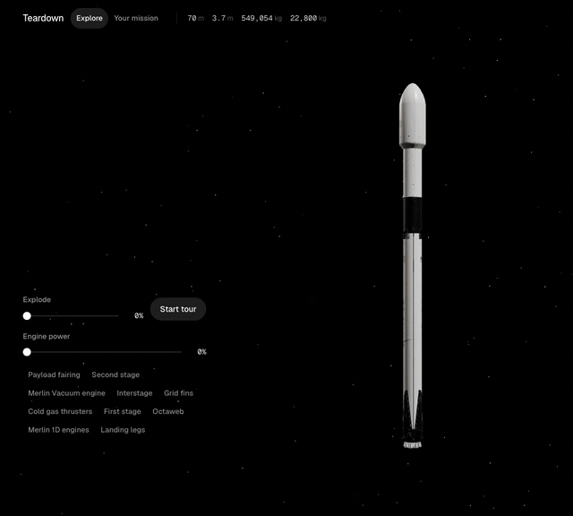
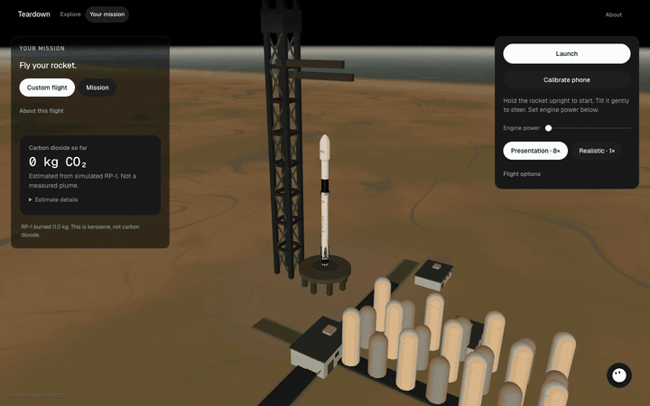
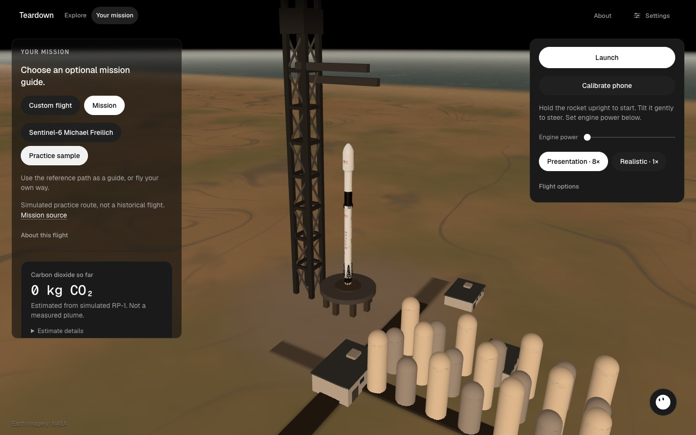
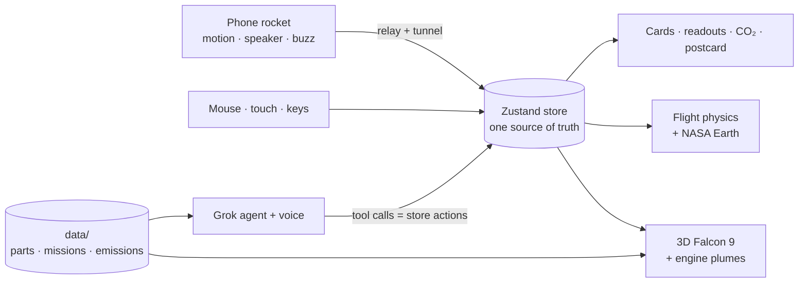

<div align="center">


<p>
  <a href="package.json"></a>
  <a href="package.json"></a>
  <a href="package.json"></a>
  <a href="package.json"></a>
  <a href="#grok-inside"></a>
  <a href="#built-for-the-spacexai-challenge"></a>
</p>

<p><b>NEEL BANSAL &nbsp;·&nbsp; ANDERS HAROLDSON</b></p>

<p>
  <a href="https://npx2218.github.io/teardown/"><b>LIVE DEMO</b></a> &nbsp;&nbsp;|&nbsp;&nbsp;
  <a href="#quick-start"><b>RUN IT</b></a> &nbsp;&nbsp;|&nbsp;&nbsp;
  <a href="https://npx2218.github.io/teardown/presentation/"><b>PRESENTATION</b></a> &nbsp;&nbsp;|&nbsp;&nbsp;
  <a href="docs/presentation/teardown.pdf"><b>PDF</b></a> &nbsp;&nbsp;|&nbsp;&nbsp;
  <a href="docs/GUIDE.md"><b>HOW IT'S BUILT</b></a>
</p>


</div>

<br />

> Millions of people watch Falcon 9 launches. Almost nobody can tell you what they just saw.
>
> The facts are all public, but they're scattered across spec sheets, webcast timestamps and launch databases, and none of it lets a kid *feel* why a rocket turns. **Teardown** is built for younger space fans. Pull a real Falcon 9 apart while Grok explains each part out loud. Then slide a phone into a cardboard rocket and fly your own flight to orbit: you hear and feel the engines in your hands, and see how every lean changes where the rocket ends up. Orbit or crash, Grok Imagine draws you a postcard of the flight to keep.

<br />

<p><sub>FALCON 9 &nbsp;/&nbsp; OVERVIEW</sub></p>

## THE ROCKET ON SCREEN

| | |
|:---|---:|
| **HEIGHT** | 70 m / 229.6 ft |
| **DIAMETER** | 3.7 m / 12 ft |
| **MASS** | 549,054 kg / 1,207,920 lb |
| **PAYLOAD TO LEO** | 22,800 kg / 50,265 lb |
| **MERLIN 1D ENGINES** | 9 × 845 kN at sea level |

<sub>Figures from <a href="https://www.spacex.com/vehicles/falcon-9/">spacex.com/vehicles/falcon-9</a>. Every number in the app comes from a sourced file in <a href="data/"><code>data/</code></a>, and Grok is told never to make one up.</sub>

<br />

<p><sub>01 &nbsp;/&nbsp; EXPLORE</sub></p>

## TAKE IT APART



Drag to turn the Falcon 9. Slide **Explode** and it splits into its 10 real parts, from the payload fairing down to the landing legs. Tap a part: it lights up, the camera flies to it, and a card explains it in plain words with real specs and a source link.

Push **Engine power** and the nine Merlin plumes grow. The phone inside the cardboard rocket roars and vibrates with them, so whatever happens on screen happens in your hands too. At 0% everything is quiet.

Press **Start tour** and **Grok Voice narrates every part** as the camera flies to it. Switch between **Kid**, **Curious** and **Engineer**: same facts, more depth.


<br />

<p><sub>02 &nbsp;/&nbsp; YOUR MISSION</sub></p>

## FLY IT TO ORBIT

You steer the rocket and set **engine power**. A small physics model does the rest, and nothing types in a win. Go straight up and you fall back. Turn too hard and you hit the ground. To reach orbit, your path has to stay at least 200 km up at its lowest point and no more than 2,000 km at its highest, with the engines off for ten seconds.

Start on the launch pad and pick how to fly:

- **Custom flight.** Just you and the physics.
- **Mission.** Add an optional guide: the published milestones of **Sentinel-6 Michael Freilich** (Falcon 9, 21 November 2020), or a practice route. The guide draws a path and names the milestones. It never steers, warns or scores you.



**Presentation · 8×** is the default, so the Earth starts to curve away in under a minute. **Realistic · 1×** is one tap away. Only real physical events end a flight: hitting the ground or the launch tower, breaking up, running out of fuel, escaping Earth, or a stable orbit.

<table>
  <tr>
    <td width="50%"></td>
    <td width="50%"></td>
  </tr>
  <tr>
    <td align="center"><sub>ON THE PAD · OPTIONAL MISSION GUIDE</sub></td>
    <td align="center"><sub>PRESENTATION 8× · EARTH CURVATURE</sub></td>
  </tr>
</table>

<a id="postcard"></a>

**Orbit or crash, every kid leaves with a postcard.** When the flight ends, Grok Imagine draws a picture for it, and the card adds the highest point, how it ended, the flight number and the estimated CO₂. **Download PNG** exports it as a 1080 × 1350 postcard to keep or print. (In the app it's called the *mission patch*; **See mission patch** reopens it without a new image.)

<br />

<p><sub>03 &nbsp;/&nbsp; HARDWARE</sub></p>

## YOUR PHONE IS THE ROCKET

A phone slides **sideways (landscape)** into a cardboard rocket and becomes its motion sensor, its speaker and its rumble. No app to install, just a web page. The engine sound and vibration are what make it click for kids: the rocket in their hands does what the rocket on screen does.

| STEP | WHAT YOU DO | WHAT HAPPENS |
|:---|:---|:---|
| **SCAN** | Scan the QR code on the laptop | Phone and laptop pair with a 4-character code |
| **ALLOW** | On the phone, press *Tap to start your rocket* | The phone asks for motion access and keeps its screen awake |
| **CALIBRATE** | Press *Calibrate phone* and hold the rocket upright | After a 3-second countdown, that pose becomes "neutral" |
| **LEAN** | Lean the rocket | The rocket on screen steers with it |

The phone uses its accelerometer and gyroscope for motion, and its speaker and vibration motor for an engine you can hear and feel. The demo phone sits landscape with its side edge toward the nose; portrait works too. **Settings** in the top bar sets engine sound, master volume and vibration, and sends them to the paired phone.

The flight needs a phone, real or simulated. If the phone disconnects, the flight pauses until it comes back. No phone at hand? Use the [phone simulator](#quick-start).

<br />

<p><sub>04 &nbsp;/&nbsp; GROK INSIDE</sub></p>

<a id="grok-inside"></a>

## ASK IT ANYTHING

| | |
|:---|:---|
| **GROK BOT** | One corner face for everything: type a question, tap a question chip, or press **Voice** (or the `V` key). It reacts while Grok listens and talks. |
| **AGENT** | Grok with function calling. It can select parts, explode the rocket and move the camera by calling the same store actions the buttons use. It can't launch or steer a flight or award a win. |
| **NARRATION** | On **Start tour**, Grok Voice explains each part out loud as the camera flies to it, at the reading level you picked. |
| **VOICE** | Grok Voice on the mascot. Voice opens a live session that can start the tour and set the explanation level (kid, curious, engineer). Text still goes through the agent. |
| **IMAGINE** | When a flight ends, Grok Imagine draws a [postcard](#postcard) of it, with the flight's numbers on the card, ready to download. |

The xAI key stays on the server. If Grok can't be reached, the exhibit keeps running and says so in a sentence.

<br />

<p><sub>05 &nbsp;/&nbsp; EMISSIONS</sub></p>

## WHAT A FLIGHT RELEASES

Every flight shows a live estimate of the carbon dioxide its engines release: the kerosene (RP-1) the simulation actually burned × **3.15 kg CO₂ per kg**, with the source in [`data/emissions/falcon9.json`](data/emissions/falcon9.json). The same number goes on the flight postcard. It's labelled as an estimate, not a measurement and not the rocket's whole lifetime footprint.

<br />

## HOW IT WORKS



Three rules hold it together:

1. **One store.** Nothing moves the scene except store actions. The phone, the mouse and Grok all call the same ones.
2. **Store actions are Grok's tools.** A test keeps the two lists in sync.
3. **Facts live in data files.** Every number on screen or spoken aloud is read from `data/`.

Under the hood, the flight steps every 1/60 s: gravity, thrust and drag, then speed, then position, then the orbit's lowest and highest points. The rocket is swept against the Earth and the launch-site shapes each step, so a fast frame can't tunnel through the pad. Phone steering blends gyro and gravity into one calibrated attitude, with a small dead zone and a turn-rate limit. The deck's [speaker notes](docs/presentation/story.md) list the main constants and the files they live in.

<br />

## BUILT FOR THE SPACEXAI CHALLENGE

| REQUIREMENT | HOW TEARDOWN MEETS IT |
|:---|:---|
| **Real space data** | Falcon 9 specs from spacex.com, Sentinel-6 Michael Freilich published milestones, NASA Visible Earth imagery, a sourced emissions file |
| **Grok Voice or Imagine** | Both: Grok Voice narrates every part and talks live with tools, Imagine draws a postcard of every flight, plus Grok function calling that drives the scene |
| **Built with Cursor** | Built in Cursor, with the plans in [`docs/plans/`](docs/plans/) |
| **Hardware for Good** | A phone in a cardboard rocket is the controller, speaker and rumble, so any classroom can build one |

<br />

## QUICK START

```bash
npm ci
cp .env.local.example .env.local   # set the variables below
npm run dev                        # http://localhost:3000
```

The committed template is `.env.local.example`. The gitignore keeps every other `.env*` file, including a name like `.env.example`, out of the repo.

| Variable | What it does |
|:---|:---|
| `XAI_API_KEY` | Authorizes the voice token (`POST /v1/realtime/client_secrets`), the text agent, and Imagine. |
| `XAI_TEXT_MODEL` | Chat model for the text guide. |
| `XAI_IMAGE_MODEL` | Imagine model, for the flight postcard. Current docs id: `grok-imagine-image-2.0`. |
| `XAI_VOICE` | Optional TTS voice id. Defaults to `eve`. The live Voice socket uses `eve` as well. |

**Pair a real phone.** The phone needs HTTPS, so run:

```bash
npm run tunnel
```

It starts the local relay and two cloudflared quick tunnels, writes their URLs into `.env.local`, and prints `READY` once both resolve. Then scan the QR code on the laptop.

**Try the phone rocket without a phone.** Run each command in its own terminal:

```bash
npm run relay:dev
```

```bash
NEXT_PUBLIC_ROCKET_RELAY=local npm run dev
```

```bash
npm run sim:phone -- ABCD
```

Open `http://localhost:3000/?demo=1` and swap `ABCD` for the code it shows. In the simulator, `h` holds it upright, the arrow keys tilt, `l` launches and `f` flicks to stage. Full key list in [`docs/SIM-PHONE.md`](docs/SIM-PHONE.md).

| URL | WHAT IT IS |
|:---|:---|
| `/` | The exhibit |
| `/?kiosk=1` | Museum mode: an attract loop after 60 s idle, and no typing in the Grok guide |
| `/?demo=1` | Keeps the same pairing code between reloads |
| `/rocket` | The page that runs on the phone |
| `/presentation` | The pitch deck (arrow keys, `N` for notes, `F` for full screen). Live at [npx2218.github.io/teardown/presentation](https://npx2218.github.io/teardown/presentation/), offline in `public/presentation/index.html` |

Run `npm test` for the unit tests (1,116 passing), `npm run test:e2e` for the Playwright flight with a simulated phone, and `npm run smoke` for the paired laptop + phone run.

<br />

## BACKGROUND MUSIC

The laptop plays a quiet loop on every page except `/rocket` and `/presentation`. The phone engine rumble is separate. It still follows engine power.

The track is **Mokka - No Copyright Music**, trimmed to the first 2 minutes with a short fade at the end, at [`public/audio/background.mp3`](public/audio/background.mp3). If that file is missing, the player uses [`public/audio/background-placeholder.mp3`](public/audio/background-placeholder.mp3), an original sine pad.

The Music slider in Settings is 0–100%. It starts at 40%. What you hear is that level times the Master sound slider. The choice is saved in this browser with the other settings. Music waits for the first tap or key press, then fades in. Reduced motion makes that fade instant.

Details: [docs/background-music.md](docs/background-music.md).

<br />

## STACK

| | |
|:---|:---|
| **APP** | Next.js 14 (App Router) · TypeScript strict |
| **3D** | three.js · React Three Fiber · drei |
| **STATE** | Zustand |
| **MOTION** | Motion |
| **PHONE LINK** | Local WebSocket relay, exposed to the phone with cloudflared quick tunnels (`npm run tunnel`) |
| **AI** | xAI Grok: chat with tools, realtime voice, Imagine |
| **TESTS** | Vitest · Playwright · scripted smoke run |

<br />

## PROJECT MAP

| PATH | WHAT LIVES THERE |
|:---|:---|
| [`app/`](app/) | Pages: the exhibit, `/rocket`, `/presentation`, and the `api/` routes that hold the xAI key |
| [`components/`](components/) | Viewer, flight, Grok guide, voice, imagine, settings, emissions and UI |
| [`lib/`](lib/) | The store, flight physics and collisions, rocket link, phone steering, settings, Grok client and agent tools |
| [`data/`](data/) | Sourced facts: parts, missions, flight presets, emissions |
| [`docs/`](docs/) | [Guide](docs/GUIDE.md), [plans](docs/plans/), [review guide](docs/REVIEW-GUIDE.md), presentation |

<br />

## TEAM

**Neel Bansal** and **Anders Haroldson** built Teardown together, with Cursor and Grok doing as much of the work as we could hand them.

<br />

## STATUS

As of 17 October 2026, Explore, Your mission, the phone link, Grok (agent, voice, Imagine) and the CO₂ estimate run on `main`. Still open:

- Our written test runs ([`docs/SMOKE.md`](docs/SMOKE.md), the Playwright flight) use the phone simulator. Real-handset runs over the tunnel are not written up yet.
- Sentinel-6 has published milestone times but no public altitude or speed series, and no propellant mass, so it guides a practice vehicle instead of replaying the real one.
- iPhone Safari has no Vibration API, so the phone buzz works on Android only. The phone says so instead of failing quietly.

The full list is in the [review guide](docs/REVIEW-GUIDE.md#known-gaps).

<br />

## CREDITS

- **3D model:** "[Falcon 9 - SpaceX](https://sketchfab.com/3d-models/falcon-9-spacex-394f7cf52d124bbd9db69f24d1ff2f08)" by Stanley Creative, [CC BY 4.0](https://creativecommons.org/licenses/by/4.0/).
- **Earth:** NASA Visible Earth (Blue Marble, Black Marble, clouds, land/water mask), public domain. See [`public/textures/CREDITS.md`](public/textures/CREDITS.md).
- **Sounds:** original synthesis, CC0. See [`public/sounds/CREDITS.md`](public/sounds/CREDITS.md).
- **Music:** Mokka - No Copyright Music. The first 2 minutes are in `public/audio/background.mp3`. See [`public/audio/CREDITS.md`](public/audio/CREDITS.md).
- **Guide avatar:** [bloub](https://github.com/jeremy-prt/bloub) by Jérémy Perret (MIT), an unofficial recreation of the Grok Bot.
- **Type:** D-DIN, Geist and Geist Mono, all under the SIL Open Font License.
- **AI:** Grok by xAI.

<br />

<div align="center">
<sub>TEARDOWN &nbsp;·&nbsp; HACKHARVARD 2026<br />Student project. Not affiliated with SpaceX or xAI.</sub>
</div>
