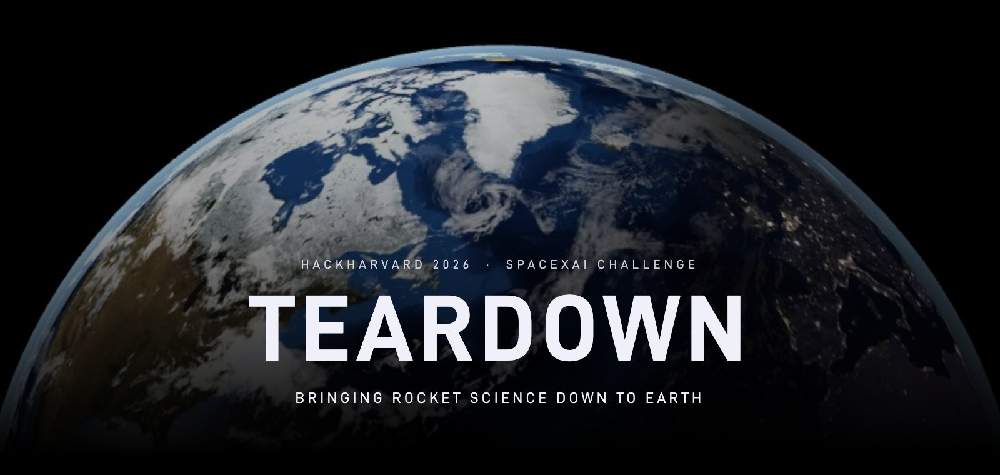
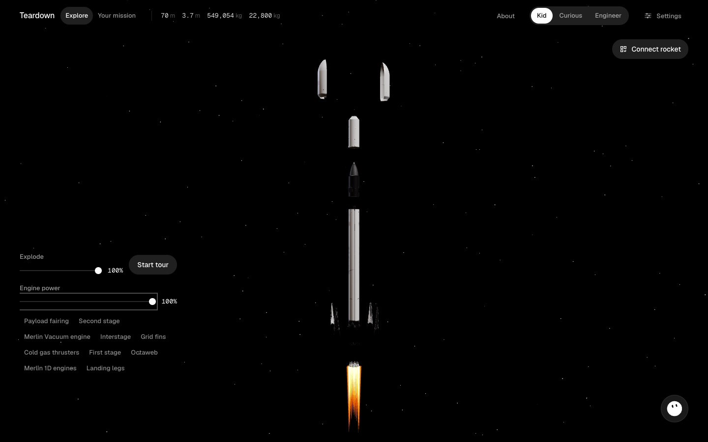
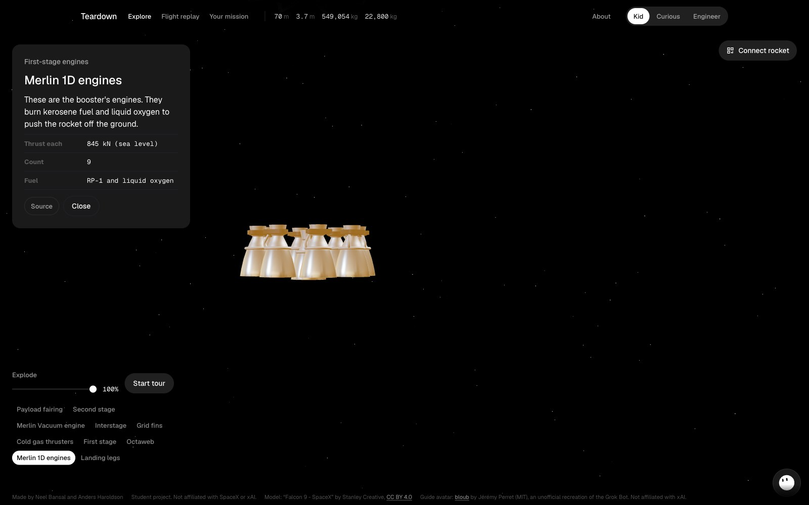
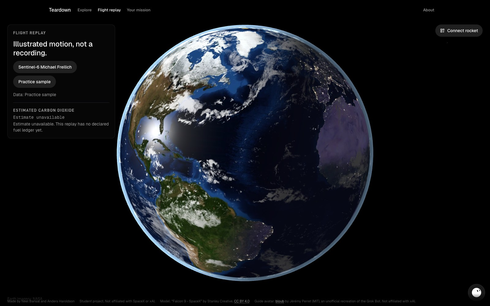
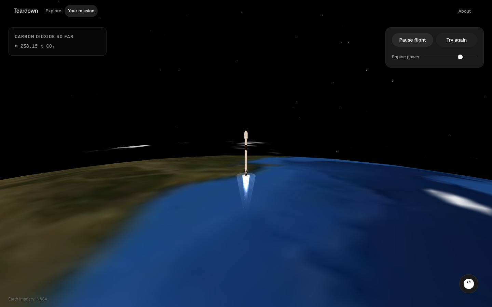
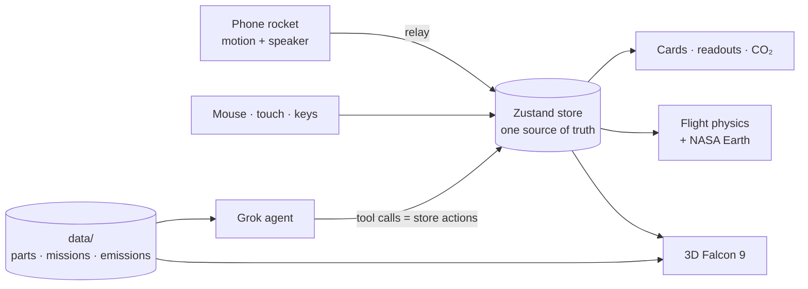

<div align="center">



<p>
  <a href="package.json"></a>
  <a href="package.json"></a>
  <a href="package.json"></a>
  <a href="package.json"></a>
  <a href="#grok-inside"></a>
  <a href="#built-for-the-spacexai-challenge"></a>
</p>

<p><b>NEEL BANSAL &nbsp;·&nbsp; ANDERS HAROLDSON</b></p>

<p>
  <a href="https://npx2218.github.io/hackharvard-teardown/"><b>LIVE DEMO</b></a> &nbsp;&nbsp;|&nbsp;&nbsp;
  <a href="#quick-start"><b>RUN IT</b></a> &nbsp;&nbsp;|&nbsp;&nbsp;
  <a href="public/presentation/index.html"><b>PRESENTATION</b></a> &nbsp;&nbsp;|&nbsp;&nbsp;
  <a href="docs/presentation/teardown.pdf"><b>PDF</b></a> &nbsp;&nbsp;|&nbsp;&nbsp;
  <a href="docs/GUIDE.md"><b>HOW IT'S BUILT</b></a>
</p>


</div>

<br />

> Millions of people watch Falcon 9 launches. Almost nobody can tell you what they just saw.
>
> The facts are all public, but they're scattered across spec sheets, webcast timestamps and launch databases. **Teardown** puts them in one place you can touch. Pull the rocket apart. Replay a real launch. Then slide a phone into a cardboard rocket and fly your own flight to orbit, with Grok explaining every moment in words a 10-year-old understands.

<br />

<p><sub>FALCON 9 &nbsp;/&nbsp; OVERVIEW</sub></p>

## THE ROCKET ON SCREEN

| | |
|:---|---:|
| **HEIGHT** | 70 m / 229.6 ft |
| **DIAMETER** | 3.7 m / 12 ft |
| **MASS** | 549,054 kg / 1,207,920 lb |
| **PAYLOAD TO LEO** | 22,800 kg / 50,265 lb |
| **MERLIN 1D ENGINES** | 9 × 845 kN at sea level |

<sub>Figures from <a href="https://www.spacex.com/vehicles/falcon-9/">spacex.com/vehicles/falcon-9</a>. Every number in the app comes from a sourced file in <a href="data/"><code>data/</code></a>, and Grok is told never to make one up.</sub>

<br />

<p><sub>01 &nbsp;/&nbsp; EXPLORE</sub></p>

## TAKE IT APART

Drag to turn the Falcon 9. Slide **Explode** and it splits into its 10 real parts, from the payload fairing down to the landing legs. Tap a part: it lights up, the camera flies to it, and a card explains it in plain words with real specs and a source link.

Switch between **Kid**, **Curious** and **Engineer**. Same facts, more depth.

<table>
  <tr>
    <td width="50%"></td>
    <td width="50%"></td>
  </tr>
  <tr>
    <td align="center"><sub>THE WHOLE VEHICLE</sub></td>
    <td align="center"><sub>EXPLODED · MERLIN 1D ENGINES SELECTED</sub></td>
  </tr>
</table>

<br />

<p><sub>02 &nbsp;/&nbsp; FLIGHT REPLAY</sub></p>

## WATCH A REAL LAUNCH

Pick **Sentinel-6 Michael Freilich** (Falcon 9, 21 November 2020) and the rocket flies it around a NASA Blue Marble Earth, hitting each milestone at its published time. The screen says plainly what it is: illustrated motion, not a recording, and it tells you which numbers are missing from the public sources.



<br />

<p><sub>03 &nbsp;/&nbsp; YOUR MISSION</sub></p>

## FLY IT TO ORBIT

You control **tilt** and **engine power**. A small physics model does the rest, and nothing types in a win. Go straight up and you fall back. Turn too hard and you hit the ground. To reach orbit, your path has to stay at least 200 km up at its lowest point and no more than 2,000 km at its highest, with the engines off for ten seconds.

The readout shows height, sideways speed, stage, fuel and the lowest and highest points of your path as you fly. Run time faster with **1× / 4× / 8×**, follow the rocket, or press **Try again**.



<br />

<p><sub>04 &nbsp;/&nbsp; HARDWARE</sub></p>

## YOUR PHONE IS THE ROCKET

A phone slides into a cardboard rocket and becomes its motion sensor and its speaker. No app to install, just a web page.

| STEP | WHAT YOU DO | WHAT HAPPENS |
|:---|:---|:---|
| **SCAN** | Scan the QR code on the laptop | Phone and laptop pair with a 4-character code |
| **ALLOW** | Tap *Start your rocket* | The phone asks for motion access and keeps its screen awake |
| **ZERO** | Hold the rocket upright and still | That pose becomes "straight up" |
| **TILT** | Lean the rocket | The 3D rocket turns with it and your flight pitches over |

If the phone disconnects, the flight pauses. Mouse, touch and keyboard can fly the whole mission without a phone.

<br />

<p><sub>05 &nbsp;/&nbsp; GROK INSIDE</sub></p>

<a id="grok-inside"></a>

## ASK IT ANYTHING

| | |
|:---|:---|
| **AGENT** | Grok with function calling. It can select parts, explode the rocket and move the camera by calling the same store actions the buttons use. It can't steer a flight or award a win. |
| **VOICE** | Grok Voice speaks the guide and the mission callouts. Hold to talk, and Grok transcribes the question. |
| **IMAGINE** | *Show in action* turns the selected part into a Grok Imagine picture, grounded in the part's data. |
| **GROK BOT** | The guide lives in a corner face that reacts while Grok listens and talks. |

The xAI key stays on the server. If Grok can't be reached, the exhibit keeps running and says so in a sentence.

<br />

<p><sub>06 &nbsp;/&nbsp; EMISSIONS</sub></p>

## WHAT A FLIGHT RELEASES

Each flight estimates the carbon dioxide its engines release: the kerosene (RP-1) the simulation actually burned × **3.15 kg CO₂ per kg**, with the source in [`data/emissions/falcon9.json`](data/emissions/falcon9.json). It's labelled as an estimate, not a measurement and not the rocket's whole lifetime footprint.

<br />

## HOW IT WORKS



Three rules hold it together:

1. **One store.** Nothing moves the scene except store actions. The phone, the mouse and Grok all call the same ones.
2. **Store actions are Grok's tools.** A test keeps the two lists in sync.
3. **Facts live in data files.** Every number on screen or spoken aloud is read from `data/`.

<br />

## BUILT FOR THE SPACEXAI CHALLENGE

| REQUIREMENT | HOW TEARDOWN MEETS IT |
|:---|:---|
| **Real space data** | Falcon 9 specs from spacex.com, the Sentinel-6 Michael Freilich launch timeline, NASA Visible Earth imagery, a sourced emissions file |
| **Grok Voice or Imagine** | Both, plus Grok function calling that drives the scene |
| **Built with Cursor** | Built in Cursor, with the plans in [`docs/plans/`](docs/plans/) |
| **Hardware for Good** | A phone in a cardboard rocket is the controller, so any classroom can build one |

<br />

## QUICK START

```bash
npm ci
cp .env.local.example .env.local   # add XAI_API_KEY and the XAI_* model names
npm run dev                        # http://localhost:3000
```

**Try the phone rocket without a phone.** Run each command in its own terminal:

```bash
npm run relay:dev
```

```bash
NEXT_PUBLIC_ROCKET_RELAY=local npm run dev
```

```bash
npm run sim:phone -- ABCD
```

Open `http://localhost:3000/?demo=1` and swap `ABCD` for the code it shows. In the simulator, `l` lifts off, the arrow keys tilt, and `f` flicks to stage. Full key list in [`docs/SIM-PHONE.md`](docs/SIM-PHONE.md).

| URL | WHAT IT IS |
|:---|:---|
| `/` | The exhibit |
| `/?kiosk=1` | Museum mode: an attract loop after 60 s idle |
| `/rocket` | The page that runs on the phone |
| `/presentation` | The pitch deck (arrow keys, `N` for notes) |

Run `npm test` for the unit tests and `npm run smoke` for the paired laptop + phone run.

<br />

## BACKGROUND MUSIC

The laptop plays a quiet loop on every page except `/rocket`. The phone engine rumble is separate. It still follows engine power.

Drop your track at `public/audio/background.mp3` (gitignored). The player loads that file when it is there. If it is missing (404), the player uses [`public/audio/background-placeholder.mp3`](public/audio/background-placeholder.mp3), an original 60 second sine pad made with ffmpeg (`scripts/make-background-music.sh`). `npm run dev` sees a file you add while it is running. `npm start` only sees files that were there when the server booted, so restart it after you add the track. Use a track you have the rights to play. Do not commit it, and do not download music from YouTube.

The Music slider in Settings is 0–100%. It starts at 40%. What you hear is that level times the Master sound slider. The choice is saved in this browser with the other settings. Music waits for the first tap or key press, then fades in. Reduced motion makes that fade instant.

Details: [docs/background-music.md](docs/background-music.md).

<br />

## STACK

| | |
|:---|:---|
| **APP** | Next.js 14 (App Router) · TypeScript strict |
| **3D** | three.js · React Three Fiber · drei |
| **STATE** | Zustand |
| **MOTION** | Motion |
| **PHONE LINK** | Local WebSocket relay, exposed to the phone with a cloudflared tunnel (`npm run tunnel`) |
| **AI** | xAI Grok: chat with tools, voice, transcription, Imagine |
| **TESTS** | Vitest · scripted smoke run |

<br />

## PROJECT MAP

| PATH | WHAT LIVES THERE |
|:---|:---|
| [`app/`](app/) | Pages: the exhibit, `/rocket`, `/presentation`, and the `api/` routes that hold the xAI key |
| [`components/`](components/) | Viewer, flight, replay, voice, imagine, emissions and UI |
| [`lib/`](lib/) | The store, flight physics, rocket link, gestures, Grok client and agent tools |
| [`data/`](data/) | Sourced facts: parts, missions, flight presets, emissions |
| [`docs/`](docs/) | [Guide](docs/GUIDE.md), [plans](docs/plans/), [review guide](docs/REVIEW-GUIDE.md), presentation |

<br />

## STATUS

As of 17 October 2026, Explore, Flight replay, Your mission and the phone link run on `main`. Still open:

- [NPX2218/hackharvard-teardown#20](https://github.com/NPX2218/hackharvard-teardown/pull/20) mounts the voice, Imagine and emissions components on the home page. Until it merges, the CO₂ line reads *Estimate unavailable*.
- The phone rocket has run against the simulator, not yet on a real handset over HTTPS.
- Sentinel-6 has published milestone times but no public altitude or speed series, so the replay shows *Reference trajectory unavailable* and draws no corridor.

The full list is in the [review guide](docs/REVIEW-GUIDE.md#known-gaps).

<br />

## CREDITS

- **3D model:** "[Falcon 9 - SpaceX](https://sketchfab.com/3d-models/falcon-9-spacex-394f7cf52d124bbd9db69f24d1ff2f08)" by Stanley Creative, [CC BY 4.0](https://creativecommons.org/licenses/by/4.0/).
- **Earth:** NASA Visible Earth (Blue Marble, Black Marble, clouds, land/water mask), public domain. See [`public/textures/CREDITS.md`](public/textures/CREDITS.md).
- **Sounds:** original synthesis, CC0. See [`public/sounds/CREDITS.md`](public/sounds/CREDITS.md).
- **Background music:** original sine pad, CC0, at `public/audio/background-placeholder.mp3`. Drop your own track at `public/audio/background.mp3` (gitignored). See [`public/audio/CREDITS.md`](public/audio/CREDITS.md).
- **Guide avatar:** [bloub](https://github.com/jeremy-prt/bloub) by Jérémy Perret (MIT), an unofficial recreation of the Grok Bot.
- **Type:** D-DIN, Barlow, Barlow Semi Condensed and Roboto Mono, all under the SIL Open Font License.
- **AI:** Grok by xAI.

<br />

<div align="center">
<sub>TEARDOWN &nbsp;·&nbsp; HACKHARVARD 2026<br />Student project. Not affiliated with SpaceX or xAI.</sub>
</div>
