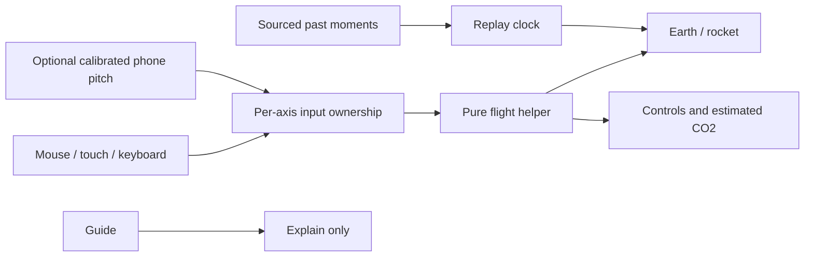

# Teardown

**Bringing rocket science down to Earth.**

> **Build status, 17 October 2026.** This branch is the story, the animated deck and the still PDF. Explore, Flight replay and Your mission are specified and **not built** here. Drawings are illustrations or labelled placeholders. No timing, score or emissions total is a measured result. Nothing has been submitted.

Teardown is a walk-up Falcon 9 exhibit for a 10-year-old and for an engineer. A visitor should be able to take the rocket apart, watch a sourced past launch, and fly their own launch from the ground into a path around Earth.

The app that does those things is the build described in `docs/specs/`. It is not this branch.

## What it is

Three modes, and nothing else in the navigation:

- **Explore.** Turn a real Falcon 9 model, pull the parts apart, and read a plain-language fact. A hard word keeps a meaning in the same sentence.
- **Flight replay.** Play published moments from a named launch, with the source and with what we do not know. It is not a live feed of speed and tilt.
- **Your mission.** Launch from a pad on a round Earth. Pitch is how you tilt. Throttle is how hard the engines push. A miss is computed. Nothing types in a win.

Estimated emissions sit inside a flight. They are not their own destination. A phone can optionally steer pitch. The laptop can fly the whole mission without one.

Made by Neel Bansal and Anders Haroldson.

## The problem

A launch is easy to watch and hard to explain.

- The facts are public, but they sit in different pages, videos and tables.
- Watching those does not let a kid take a rocket apart, ask a question, or try to fly.
- If a 10-year-old cannot follow a screen or a spoken line, the line gets rewritten. The engineer view adds depth. It does not replace the plain one.

No audience size is claimed here.

## Three modes

### Explore

Drag, pinch, or use the keys to turn the model. Pull the parts away, then tap one. The frame below is a **Placeholder**. It is not a screenshot.

### Flight replay

A replay is a list of published moments, a source, and the limits. Sample times in the specs are labelled sample. They are not a flown mission. This frame is a **Placeholder**.

### Your mission

You start on the ground, with space behind Earth. Go straight up, or turn too hard, and the path falls back. The game goal is a path around Earth: lowest point at least 200 km up, highest point no more than 2,000 km up, and the engines off for ten seconds. Those are settings for the game, not a rating of a real rocket. Altitude alone never wins.

Periapsis means the lowest part of the path. Apoapsis means the highest part. Ten quiet seconds are not a promise that the path lasts. Low Earth orbit still feels drag.

The picture below is a **Placeholder** drawing. It is not a flown path and not a success.

## Phone controller

Mouse, touch and keyboard fly the whole mission with no phone.

A phone is optional, and only over HTTPS: scan a code, allow motion, hold still to set zero, then tilt to set pitch. If the phone drops away, the flight pauses. Old wiggles are thrown out. You choose to go on with the laptop.

There is no handset photo on this branch. The frame is a **Placeholder**.

Organizers said a phone accelerometer and speaker can count for Hardware for Good. This branch has not shown that on a device. Sounds are not in the tree yet. When they arrive they have to be CC0 or public domain and listed in `public/sounds/CREDITS.md`. That file is not here.

## Estimated emissions

The carbon line is an estimate of direct engine carbon dioxide (CO₂) from fuel the simulation burned. It is not a measurement, not the rocket’s whole life, and not a soot score.

A past launch and your flight do not share one total. Historical fuel use is not measured telemetry. If a number is missing, the screen should say so. No tonne figure is stated here, because the calculator is not in this branch.

## How it works

Your hands set pitch and throttle. One owner at a time for each control. A physics helper is the only thing that moves the rocket. The picture cannot invent the path. The guide can explain the screen. It cannot steer, and it cannot award a win.

Grok text, voice and pictures need `XAI_API_KEY` in `.env.local`, read only on the server. The key is never `NEXT_PUBLIC`, never sent to the browser, and never committed. If Grok cannot be reached, the flight still runs, and the screen says it could not reach Grok. No live call has been made from this branch.

## Setup

The Next.js scaffold is not on `main` (Neel’s 01). There is no `package.json` here, so there is no verified `npm ci`, `npm test` or `npm run dev` for the exhibit.

What does run today, with no key and no network:

- Open `public/presentation/index.html` in a browser. That is the animated deck.
- Read `docs/presentation/story.md` for the speaker script.
- Open `docs/presentation/teardown.pdf` for the still copy. One slide per page, with every line visible. It does not need the network.

When the scaffold lands, the same deck is the route `/presentation`. It is not a fourth product mode. The deck’s own keys are arrows, Page Up, Page Down, Space, Home, End, F, N and Escape. They are removed when you leave the route. They are not the flight keys.

Shared Motion presets are not on `main`. The deck animates with the marked stand-in in `components/presentation/motion-fixture.ts`, using the theme timings. Swap that import for Neel’s presets when they exist. Do not install a second animation package beside `motion`.

## Presentation

| | |
|---|---|
| Animated deck | `/presentation`, or `public/presentation/index.html` offline |
| Speaker notes | `docs/presentation/story.md`, and the Notes control on the deck |
| Still PDF | `docs/presentation/teardown.pdf` |
| Direct slides | `#title` `#problem` `#explore` `#fly` `#phone` `#learn` `#how` `#close` |
| Appendix | `#sources` `#orbit` `#excluded` `#evidence` |

Right arrow or Space reveals the next line, then the next slide. Picking a slide from the list, or opening a hash, shows that whole slide. The deck does not advance by itself. Reduced motion shows the whole slide at once and drops the rise.

A public demo link and a timed recording are not ready. The frame below is a **Placeholder** for a recording of a flight that was really flown. We will not drop in a clip of a win we did not earn.

No talk length is claimed. The old checkpoint timing is retired. Measure the real slot after the flight exists, and after the event length is confirmed.

## What is not built

On purpose, and not hiding somewhere else:

- No engine-out sandbox, and no control that turns engines off to fake a lesson.
- No docking, and no space stations.
- No booster-landing game.
- No trips to the Moon or other planets.
- The old checkpoint mission, coach hints and star scores are retired.

Also not in this branch: the viewer, the flight helper, parts data, mission files, the guide, voice, image generation, the phone page, and the emissions calculator.

## Evidence still to capture

Replace a line only with a capture from the running app, a real handset, or a measured rehearsal.

- Explore capture from the running app: the real model, parts pulled apart, and a selected part.
- Flight replay capture: a named launch, its source, and the limits on what is not known.
- Your mission capture: a crash caused by flying, a retry, and an orbit reached only by flying.
- Phone photo: the code, the motion permission, the zero pose, and a tilt, plus the pause when the phone disconnects.
- A local recording of a flight that was really flown, with no forced success.
- A live demo link that has been opened and checked.
- Measured presentation time in the confirmed event slot.
- Hallway notes from people who tried the finished exhibit.
- Neel's visual review of this deck against the running app.

Editor usage pictures are not included. If they are added later, remove email addresses and billing details first.

## Credits

- Made by Neel Bansal and Anders Haroldson.
- Student project. Not affiliated with SpaceX or xAI.
- 3D model, when the file is added at `public/models/falcon9.glb`: “[Falcon 9 - SpaceX](https://sketchfab.com/3d-models/falcon-9-spacex-394f7cf52d124bbd9db69f24d1ff2f08)” by Stanley Creative, [CC BY 4.0](https://creativecommons.org/licenses/by/4.0/). The file is not in this branch. The licence and the student line are separate from the author line.
- Type on the deck: Barlow and Barlow Semi Condensed, and Roboto Mono, SIL Open Font License. See `components/presentation/fonts/NOTICE.txt`. These stand in for measured faces we do not ship. No SpaceX or xAI font, logo, wordmark or photo is included.
- No NASA model is used. The public idea of an orbit is explained by NASA; our game cut-offs are not NASA’s numbers.
- Voice, text and pictures, once a key is configured on the server: Grok (xAI). Not configured here.
