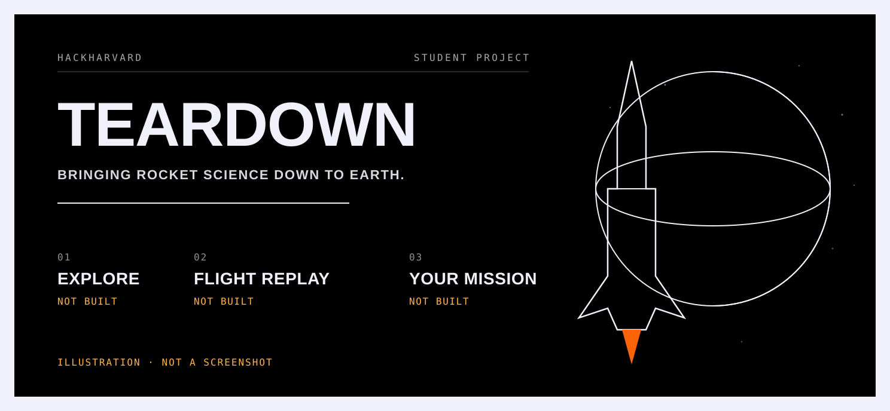
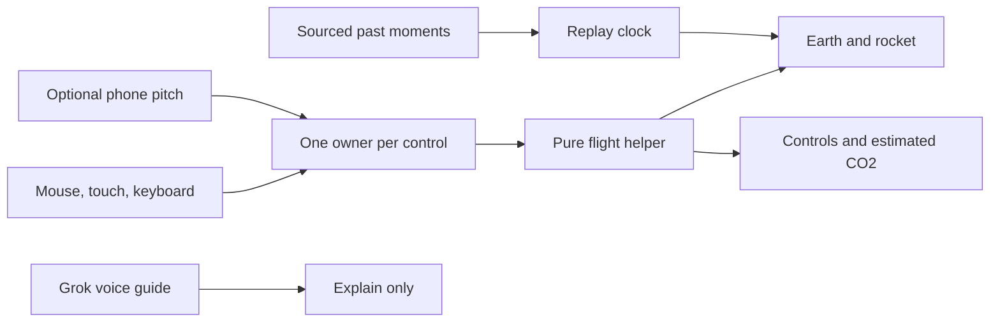

<div align="center">
<picture>
  <source media="(prefers-color-scheme: dark)" srcset="docs/media/hero-dark.svg" />
  
</picture>

<h1>Teardown</h1>

<p><strong>Bringing rocket science down to Earth.</strong></p>

<p>
  <a href="package.json"></a>
  <a href="package.json"></a>
  <a href="package.json"></a>
  <a href="package.json"></a>
  <a href="package.json"></a>
  <a href="package.json"></a>
  <a href="package.json"></a>
  <a href="#what-is-not-built"></a>
</p>

<p>Made by Neel Bansal and Anders Haroldson</p>
<p>Student project. Not affiliated with SpaceX or xAI.</p>
<p>
  <a href="public/presentation/index.html">Presentation</a>
  &middot;
  <a href="docs/presentation/teardown.pdf">PDF</a>
  &middot;
  <a href="docs/presentation/story.md">Speaker notes</a>
</p>
</div>

---

A walk-up Falcon 9 exhibit for a 10-year-old and for an engineer. Take the rocket apart, watch a sourced past launch, and fly your own from the ground into a path around Earth.

**Build status, 17 October 2026.** The Next.js scaffold is on this branch. Explore, Flight replay, and Your mission are specified and **not built**. The home page mounts empty slots. Drawings on this page are illustrations or labelled placeholders. No timing, score, or emissions total is a measured result. Nothing has been submitted.

Navigation is those three modes and nothing else. Estimated emissions sit inside a flight. They are not their own destination. A phone is allowed to steer pitch, and the laptop has to be able to fly the whole mission without one. Neither control is wired up on this branch.

## Explore

**Turn the model. Pull the parts apart. Read one plain fact.**

Drag, pinch, or use the keys. Tap a part. A hard word keeps a meaning in the same sentence. The viewer slot is empty, so this frame is a **Placeholder**. It is not a screenshot, and it is not the Falcon 9 model.


## Flight replay

**Play published moments from a named launch. Show the source. Show what we do not know.**

A replay is not a live feed of speed and tilt. Sample times in the specs are labelled sample. They are not a flown mission. This frame is a **Placeholder**.


## Your mission

**Launch from a pad on a round Earth. A miss is computed. Nothing types in a win.**

Pitch is how you tilt. Throttle is how hard the engines push. Go straight up, or turn too hard, and the path falls back.

The game goal is a path around Earth: lowest point at least 200 km up, highest point no more than 2,000 km up, and the engines off for ten seconds. Those are settings for the game, not a rating of a real rocket. Altitude alone never wins.

Periapsis means the lowest part of the path. Apoapsis means the highest part. Ten quiet seconds are not a promise that the path lasts. Low Earth orbit still feels drag.

The picture below is a **Placeholder** drawing. It is not a flown path and not a success.


## Phone rocket

**Mouse, touch, and keyboard fly the whole mission with no phone.**

A phone is optional, and only over HTTPS. Scan a code, allow motion, hold still to set zero, then tilt to set pitch. If the phone drops away, the flight pauses. Old wiggles are thrown out. You choose to go on with the laptop.

There is no handset photo on this branch. The frame is a **Placeholder**.


Organizers said a phone accelerometer and speaker can count for Hardware for Good. This branch has not shown that on a device.

## Grok voice guide

**The guide can explain the screen. It cannot steer, and it cannot award a win.**

Grok text, voice, and pictures need `XAI_API_KEY` in `.env.local`, read only on the server. The key is never sent to the browser, and never committed. If Grok cannot be reached, the flight still runs, and the screen says it could not reach Grok. No live call has been made from this branch. The voice slot on the home page is empty.

## Emissions

**An estimate of direct engine carbon dioxide (CO₂) from fuel the simulation burned.**

It is not a measurement, not the rocket’s whole life, and not a soot score. A past launch and your flight do not share one total. Historical fuel use is not measured telemetry. If a number is missing, the screen should say so. No tonne figure is stated here, because the calculator is not in this branch.

## Architecture

The intended path is short. Hands set pitch and throttle, one owner at a time for each control. A physics helper is the only thing that may move the rocket. The picture cannot invent the path. That flight is not running on this branch.



## Quick start

Scripts in `package.json`:

```bash
npm ci
npm run dev
```

The home page is a black stage. Its slots for the viewer, the mission, the phone pair, the guide, pictures, and emissions are empty. That is the shell, not a working exhibit.

The animated deck does not need that install. Open `public/presentation/index.html` in a browser. Read `docs/presentation/story.md` for the speaker script. Open `docs/presentation/teardown.pdf` for the still copy: one slide per page, every line visible, no network.

When the dev server is running, the same deck is the route `/presentation`. It is not a fourth product mode. Deck keys are arrows, Page Up, Page Down, Space, Home, End, F, N, and Escape. They are removed when you leave the route. They are not the flight keys.

Shared Motion presets are in `lib/ui/motion.ts`. The deck still animates with the marked stand-in in `components/presentation/motion-fixture.ts`, using the same timings, until that import is swapped. Do not install a second animation package beside `motion`.

## Presentation

| | |
|---|---|
| Animated deck | `/presentation`, or `public/presentation/index.html` offline |
| Speaker notes | `docs/presentation/story.md`, and the Notes control on the deck |
| Still PDF | `docs/presentation/teardown.pdf` |
| Direct slides | `#title` `#problem` `#explore` `#fly` `#phone` `#learn` `#how` `#close` |
| Appendix | `#sources` `#orbit` `#excluded` `#evidence` |

Right arrow or Space reveals the next line, then the next slide. Picking a slide from the list, or opening a hash, shows that whole slide. The deck does not advance by itself. Reduced motion shows the whole slide at once and drops the rise.

A public demo link and a timed recording are not ready. The frame below is a **Placeholder** for a recording of a flight that was really flown. We will not drop in a clip of a win we did not earn.


No talk length is claimed. The old checkpoint timing is retired. Measure the real slot after the flight exists, and after the event length is confirmed.

## What is not built

On purpose, and not hiding somewhere else:

- No engine-out sandbox, and no control that turns engines off to fake a lesson.
- No docking, and no space stations.
- No booster-landing game.
- No trips to the Moon or other planets.
- The old checkpoint mission, coach hints, and star scores are retired.

Also not running on this branch: pulling the model apart, playing a named launch, flying a path, the phone page, the guide, and the emissions line. The Falcon 9 file is in the repo. The viewer does not show it yet.

## Evidence still to capture

Replace a line only with a capture from the running app, a real handset, or a measured rehearsal.

- Explore capture from the running app: the real model, parts pulled apart, and a selected part.
- Flight replay capture: a named launch, its source, and the limits on what is not known.
- Your mission capture: a crash caused by flying, a retry, and an orbit reached only by flying.
- Phone photo: the code, the motion permission, the zero pose, and a tilt, plus the pause when the phone disconnects.
- A local recording of a flight that was really flown, with no forced success.
- A live demo link that has been opened and checked.
- Measured presentation time in the confirmed event slot.
- Hallway notes from people who tried the finished exhibit.
- Neel's visual review of this deck against the running app.

Editor usage pictures are not included. If they are added later, remove email addresses and billing details first.

## Credits

- Made by Neel Bansal and Anders Haroldson.
- Student project. Not affiliated with SpaceX or xAI.
- 3D model at `public/models/falcon9.glb`: “[Falcon 9 - SpaceX](https://sketchfab.com/3d-models/falcon-9-spacex-394f7cf52d124bbd9db69f24d1ff2f08)” by Stanley Creative, [CC BY 4.0](https://creativecommons.org/licenses/by/4.0/). The licence and the student line are separate from the author line. The viewer does not load the file yet.
- Sounds, when they are added under `public/sounds/`, have to be CC0 or public domain and listed in `public/sounds/CREDITS.md`. That credits file is not here. No sound files are in the tree.
- Type on the deck: Barlow and Barlow Semi Condensed, and Roboto Mono, SIL Open Font License. See `components/presentation/fonts/NOTICE.txt`. These stand in for measured faces we do not ship. No SpaceX or xAI font, logo, wordmark, or photo is included.
- No NASA model is used. The public idea of an orbit is explained by NASA. Our game cut-offs are not NASA’s numbers.
- Voice, text, and pictures, once a key is configured on the server: Grok (xAI). Not configured here.
