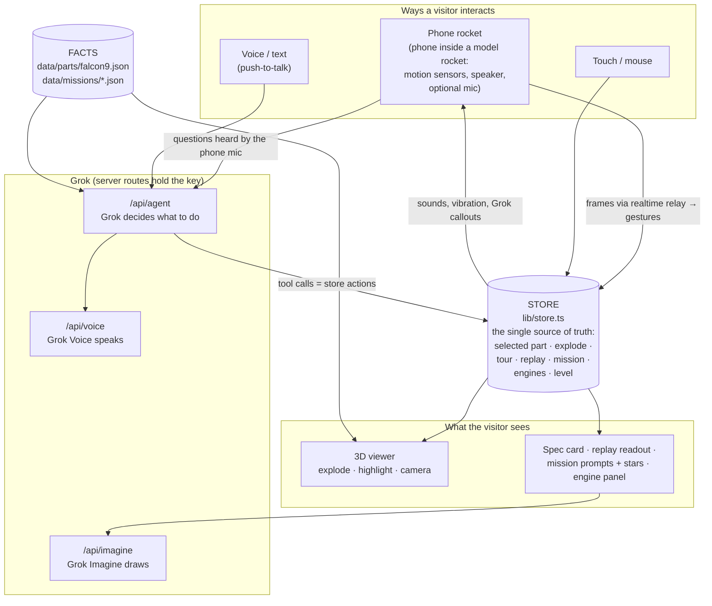
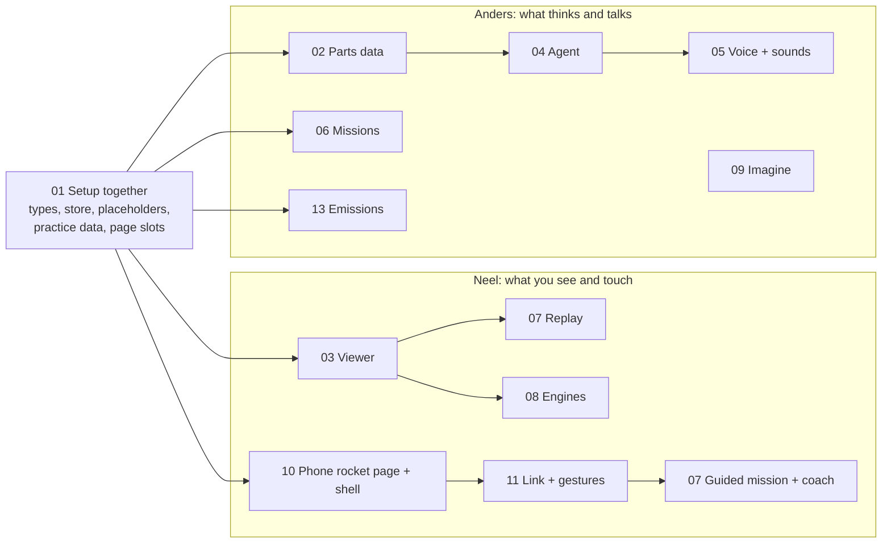

# Start Here: How Teardown Is Built

A reading guide to every doc in this folder. Read this first, then open each doc in the order below. Diagrams render on GitHub.

**Motto:** Bringing rocket science down to Earth.
**Problem:** Rockets are one of the most-watched technologies in the world and one of the least understood.
**What we're building:** a walk-up exhibit where anyone, down to a young kid, can take a Falcon 9 apart, ask Grok about it, and fly a real mission with a model rocket that has their phone inside it as the sensor and speaker.

---

## 1. The architecture in one picture



**Three ideas hold it together:**
1. **One store.** Nothing changes the scene except the store's actions. The phone rocket, touch, and Grok all call the same actions.
2. **Store actions = Grok's tools.** When Grok "does" something, it's calling a store action. A test keeps the two lists in sync.
3. **Facts live in data files.** Every number on screen or spoken by Grok comes from `data/`. Grok is told never to invent one.

---

## 2. Three things that happen, traced end to end

**A kid says "show me what lands back on Earth."**
```text
mic → transcript → askAgent (lib/agent/client.ts)
  → POST /api/agent (system prompt at Kid level + the facts)
  → Grok replies with tool calls: select_part("legs"), fly_to("legs")
  → runTool → store.selectPart / store.flyTo
  → viewer highlights the legs, camera flies there
  → Grok's answer → speakLine → Grok Voice → speaker
```

**A kid flies the guided mission with the phone rocket.**
```text
scan QR → phone opens /rocket → tap "start" (motion permission, sound unlocked)
  → phone sends ~20 frames/s through the relay → laptop: setOrientation (model turns with the rocket)
"let's fly" → Grok calls start_mission → store.startMission
clock at T+0 → waitAtCheckpoint → the ROCKET says "Lift the rocket off the pad!" · phone plays the countdown
kid lifts it → GestureDetector says "liftoff" → completeCheckpoint
  → phone: rumble + launch music + vibration · rocket: "Liftoff! We're entering the first phase of flight."
  → clock runs at 8× on the real timeline
clock reaches max-Q → pause → "Hold it steady!" → kid wobbles → coach: "Steady… keep it really still"
  → gauge fills → kid holds still 2 s ("steady") → continue
clock reaches stage separation → pause → "Flip it around!" → kid flips it → clunk, top separates
… upright → entry burn … set it down gently → "landed" + touchdown jolt
  → rocket: "Touchdown! You did it!" · missionStars (finished · quick · soft landing)
  → Grok's full comment on the laptop speaker at Kid level
```

**"What if two engines fail?"**
```text
Grok → set_engines_out([1, 2]) → store.enginesOut = [1, 2]
  → engine panel: 7 / 9 running, T/W 1.10, "barely"
  → Grok explains, using only the numbers it got from get_state
```

---

## 3. Who builds what



**No arrows cross between the two lanes.** Everything one lane needs from the other exists as a placeholder from 01, so neither of you ever waits; the store is the only place your work meets. See "How you stay independent" in `plans/00-index.md`.

| When | Neel | Anders |
|---|---|---|
| Fri 4:00 | 01 together | 01 together |
| Fri evening | 03 viewer | 02 data, 04 agent |
| Fri night (→ 2 AM) | 07 replay, 08 engines | 05 voice |
| Sat | 10 phone rocket + shell, 11 link + gestures, 07 guided mission + coach | 06 real mission, 09 Imagine, 13 emissions, 04 Task 6, sound files, hallway tests |
| Sat midnight | freeze | freeze |
| Sun → 7 AM | 12 demo video | 12 README + Devpost |

---

## 4. Reading order

Read them in this order. Each entry says what the doc decides, what to pay attention to, and what to skip on a first pass.

### ① `hackharvard-teardown-plan.md`: the *why*
- **Decides:** the problem, the audience, the prizes, the six features, the demo script, what to cut first.
- **Pay attention to:** §0 (motto, problem, design principles), §2 (features + demo script), the cut list.
- **Skip at first:** §5 research tables (model testing, node map); come back when building 02/03.

### ② `plans/00-index.md`: the *map*
- **Decides:** stage order, who owns each stage, the deadlines, and the rules every task follows.
- **Pay attention to:** Global Constraints (kid-first words, facts-only, secrets, exhibit-ready) and Review Focus (the six ways things break in a live demo).

### ③ `plans/01-setup-contract.md`: the *contract* (both of you)
- **Decides:** the shared types (`PartsFile`, `Mission`, `RocketFrame`, `Gesture`, `CheckpointId`, `SoundId`, `ExplainLevel`) and the store (state + actions + validation).
- **Pay attention to:** the store's action list. That list *is* the app's API, and Grok's tools mirror it.
- **Why it matters:** if you both agree on this file, you can build for 30 hours without blocking each other.

### ④ Anders's lane: the brain
| Doc | One line | Key thing to understand |
|---|---|---|
| `02-parts-data.md` | Facts about the 10 parts, in kid-friendly words, plus a glossary | The validator: no invented numbers, no long sentences |
| `04-agent.md` | Grok gets tools; the browser runs them and loops | Task 0 (check the real xAI API first) and the Kid / Curious / Engineer prompt |
| `05-voice.md` | Grok Voice → cached audio → browser voice, on the rocket or the laptop | `speakLine(text, { via })`: short callouts from the rocket, explanations from the laptop; `MIC_SOURCE` picks which mic hears questions |
| `06-mission-data.md` | One real Falcon 9 flight as JSON | Event times are entered by hand from the real timeline |
| `09-imagine.md` | Snapshot of the 3D view → Grok Imagine | First thing to cut if behind |
| `13-emissions.md` | Emissions view: sourced CO₂ and soot at each stage, Grok explains | Backup pitch for the sustainability track; every number has a source |

### ⑤ Neel's lane: the body
| Doc | One line | Key thing to understand |
|---|---|---|
| `03-viewer-core.md` | Load, explode, select, camera, tour, page chrome | `prepareModel` (the prototype's hard-won lessons) |
| `07-replay.md` | Hands-free replay + the **guided mission** (checkpoints, coach, stars) | `poseAt(mission, t)` is pure; the guided mission only adds "pause at checkpoints until the right move" |
| `08-engine-out.md` | Toggle engines, live thrust-to-weight | Liftoff-only math; the UI says so |
| `10-phone-rocket.md` | The `/rocket` page on the phone: sensors, sounds, vibration, Grok's voice from the rocket, optional mic, and building the shell | HTTPS only; the tap to start unlocks motion and sound |
| `11-rocket-link.md` | QR pairing, the realtime relay, gestures, moves → mission | Thresholds are guesses; tune them with the real rocket |

### ⑥ `plans/12-demo-submission.md`: the *finish line*
- **Decides:** exhibit mode, keyboard backups, hallway tests, README sections, video, Devpost.
- **Pay attention to:** the hallway test on Saturday. It's where you get real evidence for the pitch.

---

## 5. How each plan file is structured

Every stage plan follows the same shape, so once you've read one you can skim the rest:

```text
Goal · Architecture · Tech Stack · Spec · Owner · Needs     ← what and why, in 6 lines
Global Constraints                                         ← points back to 00-index
Task N
  Files:        exactly which files are created or changed
  Interfaces:   function names and types other stages rely on
  Step 1        write the failing tests (named G1, F3, P2… so they're easy to find)
  Step 2–4      run, implement, run again
  Verify        what to check by hand in the browser or on the device
  Commit        one small commit per task
```

**Building with Cursor:** open the plan and tell Agent *"Read docs/plans/00-index.md and docs/plans/NN-name.md. Implement Task N only. Run the tests. Stop."* Review, commit, next task.

---

## 6. Glossary for the docs themselves

| Term | Meaning |
|---|---|
| **Store** | The shared app state (`lib/store.ts`). Everything reads it; only its actions change it. |
| **Tool** | A function Grok is allowed to call. Each one maps to a store action. |
| **Facts layer** | `data/parts` and `data/missions`. The only source of numbers. |
| **Pose** | Where every part of the rocket is at a given mission time. |
| **Phone rocket** | A phone slid into the model rocket, running `/rocket`: it sends motion and plays sounds. |
| **Relay** | The hosted realtime service that carries messages between the phone and the laptop. |
| **Gesture** | A move of the rocket the app recognizes: liftoff, lean, steady, flip, upright, landed, shake. |
| **Guided mission** | The main mode: the real timeline pauses at six checkpoints until the visitor does each move; ends with stars. |
| **Coach** | While a checkpoint waits, compares the rocket's live tilt and motion with the target and has the rocket give hints; Grok coaches live if someone is stuck 15 s. |
| **Exhibit / kiosk mode** | `?kiosk=1`: touch and the phone rocket only, resets when idle, invites the next visitor. |
| **Sync point** | A time you both merge to `main` and check that the halves connect. |
