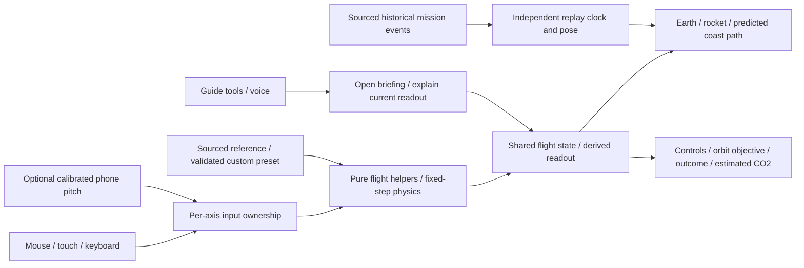

# Start Here: How Teardown Is Built

Read the [spec index](specs/README.md), [build index](plans/00-index.md), then the owning stage spec. The 2026-10-17 [orbital-mission revision](specs/07-replay.spec.md) and [build plan](plans/07-replay.md) replace the previous guided checkpoints, coach and stars.

**Motto:** Bringing rocket science down to Earth.
**Product:** a walk-up Falcon 9 exhibit where visitors inspect the vehicle, explore a sourced historical flight, and fly their own Earth launch-to-orbit mission.

## Current scope

| Surface | What belongs here |
|---|---|
| Explore | Real rocket model, rotate/zoom, explode, parts, facts and tour |
| Flight replay | Named real mission, sourced approximate milestones, clear telemetry limits, play/pause/seek and estimated emissions |
| Your mission | Full 3D Earth and ground launchpad, player pitch/throttle, staging, fuel, crashes/retry, computed orbit, historical-reference/custom presets and live estimated emissions |
| Corner guide | Subtle Grok-style mascot opens the existing guide; actual provider/local state remains honest |

Engine-out is deferred and its old build instructions are commented out. Emissions have no separate navigation item, lens or independent flight clock. Docking, stations, booster-landing gameplay, planet travel and a galaxy simulation are outside this build. The background is space around Earth.

## Architecture

The guide cannot steer or award success. The player simulation does not follow a prerecorded mission clock. Historical milestones do not supply continuous trajectory telemetry. Simulation values, sourced facts and estimated emissions have distinct labels and provenance.

## Who builds what

| Owner | Area | Start with |
|---|---|---|
| Both | Shared flight state/types, mode exclusivity, input ownership and lifecycle | 01 plus 07 §6 migration |
| Neel | Viewer, globe/cameras, flight helpers, local controls, optional phone input, flight HUD | 03, 07, 10/11 |
| Anders | Parts/historical data, scenario evidence, guide/voice, estimated-emissions data and adapter | 02, 04/05, 06, 13 |
| Both | Design review, browser/hardware acceptance, revised timed demo and submission | 00, 12 |

Local controls must support the complete mission without a phone or provider connection. Pairing/audio mechanisms remain reusable, but the checkpoint-completion bridge is retired. Phone loss pauses the flight and requires explicit resume or a local-control handoff.

## Build order and evidence

1. Read 07's approved scope, physics boundary and cross-stage migration table.
2. Settle shared types and validated source/custom scenario inputs.
3. Prove physical stepping, fuel/staging, crash conditions and the orbital objective in pure-helper tests.
4. Build the globe and controls; complete successful and failed runs through public controls.
5. Integrate emissions, historical replay, optional phone/voice and guide adapters.
6. Apply the clean SpaceX/xAI layout, mascot and exact “Made by Neel Bansal and Anders Haroldson” footer; retain model credit and student disclaimer.
7. Check browser layouts/input/reset and remeasure the demo timing.

The provisional orbit objective uses a bound path with periapsis at least 200 km, apoapsis at most 2,000 km and ten seconds of engine-off coast; these are documented gameplay settings, not measured mission requirements or a promise of permanent orbit. Altitude alone never wins.

Run `python3 docs/specs/check_contracts.py` to check document structure and the existing shared fixtures. The [review record](specs/REVIEW.md) distinguishes old extracted-code evidence from the revised game's still-unexecuted acceptance requirements. The saved local preview is kept separately on `codex/mvp-preview`; it is a reference artifact, not the completed new specification.
