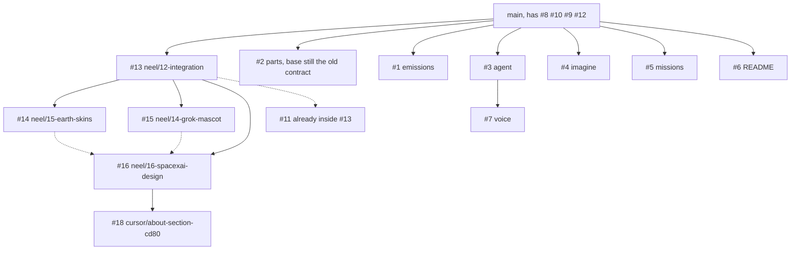

# Teardown: read this first

`#8`, `#9`, `#10`, and `#12` are already on `main`. This is what is still open as of 17 October 2026. Review and merge it in the order below. Budget **about 16 minutes**. Repo: https://github.com/NPX2218/hackharvard-teardown

Shared contract on `#8` is **2026-10-17.1**. The integration head (`#13`) is **2026-10-17.2** (`SHARED_CONTRACT_VERSION` in `lib/types.ts`).

## What it is now

Teardown is a two-screen exhibit. The laptop shows a Falcon 9 you can take apart, then a live flight around an Earth you can see, steered by pitch and throttle. A phone in the cardboard rocket is the controller: it pairs with a 4-character code, calibrates upright, and sends motion. Free flight can crash or orbit. Mission mode can follow Sentinel-6 Michael Freilich by its published milestone times. A corner Grok Bot (an unofficial MIT port, credited) watches the guide button. Anders's lane adds the Falcon 9 words, a CO₂ estimate from the RP-1 the flight actually burns, a Grok agent, "show in action" pictures, laptop speech, and the README plus deck. The store is the meeting point. Lanes do not import each other's components.

## Where the PRs sit

`main` already contains `#8`, `#10`, `#9`, and `#12`, in that merge order. `#13`'s GitHub base is already `main`. `#14`, `#15`, and `#16` still say their base is `neel/12-integration`. `#18` sits on `#16`. `#11` still says its base is `neel/10-phone-rocket`. Anders's `#1`–`#6` still say their base is `neel/01-setup-contract`, which is the merged `#8`. `#7` sits on `#3`. `#13` is at `7c0cfbc` (Grok speech stays on the laptop). `#7` is at `20c5ae5`. `#16` is at `39f1c99`. Style-only follow-ups also sit on `#1`, `#3`, and `#4`.



Solid arrows are the GitHub base, except Anders's arrows, which are where those PRs need to point once you retarget them. Dotted arrows mean the branch already contains that work.

## Merge order

Merge into `main` from the top of the list below. `#8`, `#10`, `#9`, and `#12` are done. After each merge, **retarget the next PR's base to `main`** (GitHub: Edit, change base) before you merge it. If you merge a child into its old base branch, you dump that work onto a branch you are about to leave behind.

`#13` merges cleanly onto current `main` and already contains `#11`. Do not merge `#11` on its own. `#12` is on `main`, and merging `#11` on top of `#12` conflicts in `lib/store.ts` and `lib/rocket/commands.ts`. After `#13` is in `main`, retarget `#11` from `neel/10-phone-rocket` to `main`. The compare should be empty. Close it.

`#14` and `#15` touch different files. Either order works. This list does Earth, then the mascot. After `#13`, retarget both from `neel/12-integration` to `main`. `#16` merges cleanly after those two: the only new diff is the restyle. Then `#18`, whose base is `#16`. `#7` must come after `#3`, then retarget `#7` from `cursor/agent-grok-tools-dfdf` to `main`. Before each Anders PR, retarget it off `neel/01-setup-contract` onto `main`.

`#17` is this guide. Merge it whenever. It does not change the app.

1. **#13 Integration** (2 min). Phone pitch into the flight, disconnect pause, kiosk attract, help, guide button. This merge brings `#11` with it. Base is already `main`. Read `lib/flight/phone-pitch.ts`, `lib/viewer/exhibit.ts`, `components/ui/PairRocket.tsx`, `lib/rocket/useRocket.ts`. Check: `/?demo=1` keeps one pair code. Press `?` and the shortcut list opens. (`M` and Space only work in `?kiosk=1`.)
2. **#11 Rocket link** (0.5 min). Already in `#13`. Read `lib/rocket/commands.ts`, `scripts/sim-phone.ts`, `docs/SIM-PHONE.md` only if you want the gesture table. Check: the PR's compare against `main` is empty. Close it.
3. **#14 Earth skins** (1 min). NASA day, night, clouds, ocean mask, atmosphere. Read `components/flight/Earth.tsx`, `components/flight/earthShaders.ts`, `public/textures/CREDITS.md`. Check: Your mission. The globe is a photograph, and a small caption credits NASA.
4. **#15 Grok mascot** (1 min). Corner bot, moods, bloub credit. Read `lib/mascot/mood.ts`, `lib/mascot/voice-bridge.ts`, `components/ui/GuideLauncher.tsx`. Check: the corner control is a face. Click it. The guide opens. Credits mention bloub.
5. **#16 SpaceXAI redesign** (1.5 min). Dark x.ai chrome on every surface, D-DIN only on the kiosk and the flight HUD. The branch already contains `#14` and `#15`. Layout and CSS only. Read `app/globals.css`, `app/layout.tsx`, `components/ui/Header.tsx`. Check: the header is one quiet bar, the HUD labels are the condensed face, the mascot sits in a small circle, and the phone status word stays white. On this branch alone, vitest reports 54 files and 415 tests. That count does not include Anders's suites.
6. **#18 About sheet** (1 min). Header button, sourced SpaceX sentences, HackHarvard note, model credit. Read `components/about/copy.ts`, `components/about/AboutSheet.tsx`, `components/ui/Header.tsx`. Check: About opens a sheet. The SpaceX lines name spacex.com. The disclaimer says not affiliated.
7. **#2 Parts** (1 min). Falcon 9 copy: 10 groups and a 19-term glossary, checked against the contract types. Read `data/parts/falcon9.json`, `lib/parts.ts`. Check: a part card uses this wording (payload fairing, grid fins), not the placeholder file.
8. **#1 Emissions** (1 min). RP-1 × **3.15** kg CO₂ per kg kerosene, sourced file, readout. Read `data/emissions/falcon9.json`, `lib/emissions.ts`, `components/emissions/EmissionsReadout.tsx`. Check: the factor in the JSON is 3.15. The flight HUD still shows the seam fixture until the import in Known gaps is swapped.
9. **#3 Agent** (1.5 min). Grok client, tools, `/api/agent`, text box. Read `lib/agent/tools.ts`, `lib/agent/prompt.ts`, `app/api/agent/route.ts`. Check: with no `XAI_API_KEY`, a question fails closed (a sentence, not a stack trace). Tools must not pause or finish a flight.
10. **#4 Imagine** (1 min). Grounded prompt, `/api/imagine`, "Show in action". Read `lib/imagine/prompt.ts`, `app/api/imagine/route.ts`, `components/imagine/ImagineSlot.tsx`. Check: the component exists. The home page still mounts the fixture, so you will not see the button until the import swap.
11. **#7 Voice** (1.5 min). Laptop TTS and realtime mic, callouts, 9 CC0 sounds, `onVoiceState`. Read `lib/voice/speak.ts`, `lib/voice/activity.ts`, `components/voice/PushToTalk.tsx`. Check: `speak.ts` plays on the laptop (`20c5ae5`). `public/sounds/` has the 9 mp3s plus `CREDITS.md`. Hold `V` is implemented on `PushToTalk`, which is not mounted yet.
12. **#5 Missions** (1.5 min). Sentinel-6 record and flyable scenario presets. Read `data/missions/sentinel-6-michael-freilich.json`, `data/missions/index.ts`, `data/flight/index.ts`. Check: Mission mode shows Sentinel-6 Michael Freilich as a real button. Open **About this flight**. The note says "Reference trajectory unavailable", and the classroom line says a Sentinel-6 reference flight cannot start because propellant mass is not in the selected sources. Practice is a separate sample, not the silent default.
13. **#6 README and deck** (1 min). Launch-poster README, `/presentation`, speaker notes, PDF. Read `README.md`, `docs/presentation/story.md`, `components/presentation/slides.ts`. Check: the README still says the exhibit is **not built** and the pictures are labelled placeholders. Merge it last, or merge it knowing the poster is behind the app. The deck still imports `components/presentation/motion-fixture.ts` rather than `lib/ui/motion.ts`.

## After #7 and #15 are both in the same tree

The mascot already calls `connectVoiceActivity()`, which no-ops until `lib/voice/activity.ts` exists. Replace that with a direct subscription so the face follows the laptop mic and the laptop speaker. In `components/ui/GuideLauncher.tsx`, add the imports and call `bindVoiceActivity` from the mount effect (the one that now calls `connectVoiceActivity`). Do not call it at module scope. That file is a client component and the bus touches the browser.

```ts
import { onVoiceState } from "@/lib/voice/activity";
import { bindVoiceActivity } from "@/lib/mascot/voice-bridge";
bindVoiceActivity(onVoiceState);
```

The home page was not updated by those PRs. It still mounts the seam fixtures. Swap these three imports or Anders's UI never appears:

- `app/page.tsx`: `VoiceSlot` from `@/components/voice/VoiceSlot`, `ImagineSlot` from `@/components/imagine/ImagineSlot`
- `components/flight/EmissionsPlacement.tsx`: `EmissionsSlot` from `@/components/emissions/EmissionsSlot`

## Known gaps

- Sentinel-6 has published event times only. Every reference sample has null altitude and velocity. No public kinematic series was checked in. Mission mode tracks milestones and shows **Reference trajectory unavailable**. It does not draw a corridor, and it will not warn or fail for drift. Practice is separate: a PRACTICE corridor recorded from the classroom simulator (simulated practice reference, not historical). Mission mode on Practice can warn and fail for drift.
- A real phone on HTTPS was not run. Localhost is a secure context, so `/rocket` gets past the https gate there. Motion permission, wake lock, and the cardboard shell are untested on hardware.
- `public/audio/manifest.json` is `{}`. Narration audio is not cached. `scripts/cache-narration.ts` is the generator. It needs `XAI_API_KEY`.
- No Imagine JPEGs are in the repo (`public/imagine/` is absent). `scripts/save-imagine.mjs` is the cache script. Pictures need a key.
- Grok speech plays on the laptop only. `lib/rocket/commands.ts` drops `say` and `stopSay`, so the phone never speaks those lines. The phone still plays rocket sounds and vibration. `lib/voice/rocket-port.ts` is wired at `commands.ts`, and those two speech messages stop there.
- `#6` media are labelled placeholders, and the README status badge still says not built.
- `app/page.tsx` fixtures, called out above. Until that swap, hold-`V`, the agent box, and Show in action are not on the exhibit.
- Earth credit is in `public/textures/CREDITS.md` and the flight caption. The global footer credit for NASA is still a one-line follow-up. The mascot PR owns `components/ui/Credits.tsx`.

## Run the demo on one machine

No accounts or keys. Two processes plus the simulator (for a real phone, run `npm run tunnel` instead; it starts the relay and the cloudflared tunnels and prints READY when the phone can scan):

```bash
npm ci
npm run relay:dev
```

In a second terminal:

```bash
NEXT_PUBLIC_ROCKET_RELAY=local npm run dev
```

Open `http://localhost:3000/?demo=1`. Read the 4-character code. In a third terminal, with the same relay:

```bash
npm run sim:phone -- ABCD --mount s24fe
```

`ABCD` is whatever the laptop is showing. Keys: `l` lift to launch, arrows tilt, `f` flick to stage, `a` nose-down abort. The default mount is the Galaxy S24 FE, landscape, buttons toward the nose. Details are in `docs/SIM-PHONE.md`. The relay listens on `ws://127.0.0.1:8787`.

`/?kiosk=1` is the attract loop (60 seconds idle). `?` opens help.

## Smoke

`scripts/smoke/merge-all.sh` repeats this merge order in a throwaway worktree, applies the glue line, and runs `tsc`, lint, vitest, and `next build`. `npm run smoke` plays the paired laptop and phone. Results and app bugs are in `docs/SMOKE.md`.
